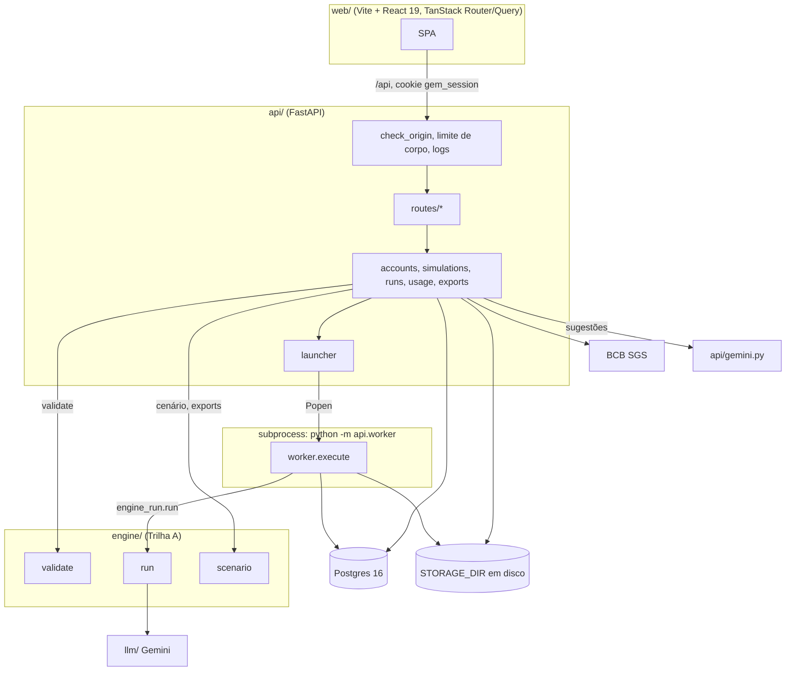
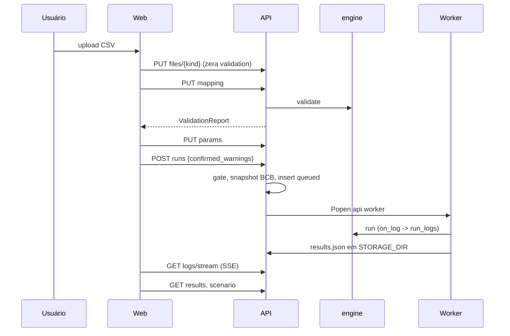

# Codebase Map

> Gerado pelo Cartographer em 2026-11-08T18:03:10Z. Diz **onde** está cada coisa; `docs/decisoes/` diz **por quê**. Regras em `CLAUDE.md`, `CODE-STYLE.md`, `DATABASE.md`, `API-GUIDE.md`, `SECURITY.md`. `docs/superpowers/` (specs e planos, ~396k tokens) e `tests/fixtures/` não foram lidos.

## Visão geral



**Entry points:** `api.main:app` (uvicorn, `:8000` em dev, `$PORT` na imagem), `python -m api.worker <run_id>`, `python -m api.cli create-admin`, `python -m engine --config run.json --out DIR`, `alembic -c api/alembic.ini`.

## Estrutura

```
api/            FastAPI, SQLAlchemy 2 (síncrono), Alembic, psycopg 3
  routes/       routers finos: auth, members, admin, simulations, runs, engine
  migrations/   versions/0001..0006
engine/         motor estatístico (pandas/statsmodels/sklearn pinados)
llm/            get_llm(), Protocol LLM, adaptador Gemini
web/            src/{routes,lib,components}, e2e/ (Playwright), public/templates/*.csv
tests/          api/, engine/, llm/, fakes/, bigquery/, fixtures/{parity,results}
docs/           m2/ (spec), decisoes/ (porquês), superpowers/ (planos)
Dockerfile      imagem única: web (bun) -> builder (uv) -> runtime não-root
docker-compose.yml  só Postgres 16
mise.toml       tasks: test, api, web, worker, db-migrate, create-admin, parity*, e2e
.github/workflows/ci.yml  jobs py (Postgres), web, e2e
```

## api/

| Arquivo | Papel |
| --- | --- |
| `main.py` | `create_app(web_dist)`; middlewares `check_origin` -> `refuse_oversized_body` (32 MiB, só Content-Length) -> `logs.request_context`; handlers 503 (`passwords.Busy`) e 422 sem `input`; `mount_spa` com fallback e proteção contra path traversal |
| `db.py` | `DATABASE_URL`, engine (`pool_pre_ping`, `connect_timeout=2`), `get_db`, `ping` |
| `models.py` | User, Workspace, Membership, UserSession, Simulation, SimulationFile, Run, RunLog; `JSONB(none_as_null=True)` |
| `auth.py` | sessão (cookie `gem_session`, sha256 no banco, idle 8 h, teto 7 d), login/lockout, `require_role`, `check_origin`, `RANK` |
| `passwords.py` | scrypt N=2^17; `BoundedSemaphore(4)`, espera 5 s, depois `Busy` |
| `accounts.py` | membros, workspaces, reset/ativar, `create_platform_admin`, `LastAdmin` |
| `simulations.py` | upload por sha256, mapping, params, sugestões, `lock` (FOR NO KEY UPDATE), delete |
| `runs.py` | `create`, gate `block_reason`, `fail_stale` (20 min, sob demanda), publish, `scenario`, `visible` |
| `launcher.py` / `worker.py` | `Popen` fire-and-forget com BLAS 1 thread e `LLM_PROVIDER=none`; worker faz claim atômico, grava logs e `results.json`, watchdog de 20 min |
| `engine_run.py` | delega a `engine.run`, ou fake com `ENGINE_FAKE=1` (`FAKE_ENGINE_*`) |
| `engine_config.py` | `ParamsIn` = `EngineConfig` recortado por `ANALYST_FIELDS` |
| `validation.py` | wrapper de `engine.validate(...).model_dump` |
| `suggestions.py`, `gemini.py` | sugestões dos dados e do Gemini (só agregados no prompt, timeout 20 s) |
| `bcb.py` | séries SGS (433 IPCA, 432 Selic, 24364 IBC-Br) via httpx; falha = 502 |
| `bigquery.py`, `google_import.py` | conector Google (fora do escopo; código e testes ficam) |
| `exports.py`, `csvfile.py` | CSV pt-BR (`;`, vírgula decimal, BOM, `safe()` contra fórmula); leitura robusta de upload |
| `usage.py` | view `usage` por workspace x usuário x mês |
| `storage.py` | `put/path/delete_prefix` sobre `STORAGE_DIR` |
| `logs.py` | JSON no stdout com `user_id/workspace_id/run_id` via dict mutável (`tag`) |
| `cli.py` | `create-admin` |

### Endpoints (resumo; tabela completa em `API-GUIDE.md`)

- Público: `GET /api/health` (sempre 200), `POST /api/auth/login`.
- Sessão: `POST /api/auth/logout`, `POST /api/auth/password`, `GET /api/me`, `GET /api/engine/config-schema`.
- Platform admin (`/api/admin`): workspaces (+ `PUT/DELETE …/google`), users (reset-password, PATCH active), `usage`, `usage.csv`.
- Admin do workspace: `/api/w/{slug}/members` (CRUD), `DELETE …/simulations/{id}`.
- Analyst+: simulações (CRUD, `files/{kind}`, `mapping`, `params`, `suggestions`, `suggestions/gemini`, `google-import`), `POST …/runs`, publish/unpublish, `GET …/runs/{id}/inputs/{key}`.
- Viewer+ (viewer só vê run publicado, senão 404): `GET …/runs`, `…/runs/{id}`, `/results`, `/scenario`, `/events.csv`, `/scenario.csv`, `/curve.csv`, `/logs/stream` (SSE).

### Banco (migrations 0001–0006)

`users`, `workspaces` (`settings` jsonb, `google`), `memberships` (PK composta, enum de papel), `sessions`, `simulations` (`config`, `validation`), `simulation_files` (PK `(simulation_id, kind)`), `runs` (snapshot de config/inputs; índice único parcial `runs_one_active_per_simulation`), `run_logs`, view `usage` (mês em America/Sao_Paulo, fim limitado a `created_at + 20 min`). `0006` renomeia `require_significance`/`require_good_fit`.

## engine/

Pipeline em `pipeline.py`: `run()` valida config -> `get_llm()` -> `validate` (primeiro erro vira `EngineError(check_id)`) -> `compute()` = `load_inputs` -> `detect_events` -> `analyze_events` -> `run_elasticity` -> `identifiability.assess` -> `judge_sufficiency` -> `outputs.write_legacy_outputs` -> `narratives.build` -> `results.build_results` -> `results.json`.

| Arquivo | Papel |
| --- | --- |
| `config.py` | `EngineConfig` (pydantic, `extra=forbid`), `GATE_DEFAULTS` provisórios, `to_legacy_dict()` |
| `inputs.py`, `validation.py` | leitura dos 3 CSVs e `validate` (19 check ids; colinearidade A3, VIF, grupos) |
| `analysis.py` | eventos, causal (UnobservedComponents), placebo, WMAPE OOS, controles (Lasso) |
| `elasticity_analysis.py` | MMM em 2 estágios (Ridge, Hill/adstock por L-BFGS-B), bootstrap, curvas, banda p5/p95 |
| `identifiability.py` | IC bootstrap da contribuição; esconde canal (`"Não identificados"`) |
| `sufficiency.py` | `spend_cv_min` 0.10, `oos_wmape_max` 0.30; rebaixa eventos para `insufficient_run` |
| `scenario.py` | `ramp`, notas tCPA/tROAS, `scenario()` mensal (`30/period_days`), `ScenarioFilters` |
| `results.py`, `results_schema.py` | monta/sanitiza (NaN -> null) e contrato `ResultsV1` (`schema_version=1`) |
| `outputs.py`, `presentation.py` | saídas legadas (PNG/CSV/MD); cópias do protótipo |
| `narratives.py`, `grounding.py` | narrativas por LLM (A9) a partir do `results.json` e checador pós-geração (números, datas e canais contra o payload); uma regeneração, depois texto determinístico |
| `data_preprocessor.py` | leitura robusta, cadência, parciais, outliers, adstock; cópia evoluída do protótipo |
| `logmessages.py` | traduz logs para pt-BR por regex (mudar uma mensagem quebra a tradução em silêncio) |
| `errors.py`, `version.py` | `EngineError`; `ENGINE_VERSION` env -> git -> metadata |

`results.json` v1: `status` (`succeeded|inconclusive|failed`), `validation`, `sufficiency`, `causal`, `elasticity`, `baseline`; `experiment_design` sempre `null` (A7); `reports` vem da A9 (`null` se `narratives` falhar por erro interno). Gates de evento: `not_significant`, `illogical_direction`, `poor_fit`, `placebo_failed`, `model_dependent`, `insufficient_run`, `analysis_failed`.

## web/

- **Rotas** (`src/routes`): `login`, `trocar-senha`, `_auth` (guarda via `meQuery`), `_auth/w/$slug/{index,membros,simulacoes/nova,simulacoes/$id,execucoes/index,execucoes/$runId/{index,causal,elasticidade,detalhes}}`, `_auth/admin/{workspaces,usuarios,uso}`. `routeTree.gen.ts` é gerado e versionado.
- **lib/**: `api.ts` (`ApiError`), `auth.ts` (`meQuery`, `safePath`, `errorMessage`), `simulations.ts` (`runBlockReason` espelha `api/runs.block_reason`), `params.ts` (form gerado do JSON Schema), `runs.ts` (`useRunLog` SSE), `results.ts` (tipos e formatação pt-BR; `reasonLabel`), `scenario.ts`, `theme.ts`.
- **components/**: `ui/` é shadcn gerado; nossos: `AppHeader`, `ParamsForm`, `FileDrop`, `RunDetails`, `ExportBar`, `causal/*`, `elasticity/*`, `GoogleConnectorDialog`, `TempPasswordDialog`, `DeleteSimulation`.
- **main.tsx**: `onApiError` central (401 -> `/login?redirect=`, `password_change_required` -> `/trocar-senha`, 403/404 invalida `/me`). `resultsQuery` e `scenarioQuery` têm `staleTime: Infinity`.
- **e2e/**: Playwright contra `uvicorn :8001` servindo `web/dist` (rode `bun run build` antes), banco `app_e2e`, `workers: 2`, `FAKE_ENGINE_RESULTS` = Gol anonimizada.

## Fluxos



Auth: login faz commit antes do scrypt, 5 falhas bloqueiam 15 min, e-mail inexistente roda scrypt falso. Troca de senha, reset e desativação derrubam sessões. Outro workspace = 404, papel insuficiente = 403, platform admin = admin implícito.

## Convenções

- Toda rota/query escopada por workspace; dependência `require_role` dá `ctx.workspace.id`.
- Matemática só em Python; o front formata, não recalcula.
- Nome de coluna nunca hardcoded (vem do `column_mapping`); nada de `print()`; UI e `detail` de erro em pt-BR, código e esquema em inglês.
- Rota nova: linha em `API-GUIDE.md` e em `ROUTES` de `tests/api/test_rbac.py`. Tabela/coluna nova: `DATABASE.md` e migration.
- `uv` e `bun`, não pip/npm. ruff linha 120.

## Gotchas

- **Testes:** `tests/conftest.py` define `DATABASE_URL` (`app_test`) antes de importar `api`; cada teste roda em transação com rollback. `ENGINE_FAKE=1` vale em todo teste (autouse); `bcb.get` levanta `AssertionError` por padrão. Paridade (`test_parity.py`) só roda em Linux com as mesmas versões de numpy/pandas/scipy/statsmodels/sklearn; `test_parity_real` precisa de dados confidenciais.
- **BLAS:** o worker fixa 1 thread; com multithread a curva muda (~7e-4) e o MMM depende da CPU.
- **Worker:** sem fila nem limite de concorrência; run morto só é marcado `failed` quando alguém consulta (`fail_stale`, 20 min, duplicado na view `usage`).
- **Gemini:** `api/gemini.py` ainda é usado pela API para as sugestões; o worker chama o Gemini pelo `llm/` (A9). Migração pendente (Dev B).
- **Motor:** `diminishing_return` e `saturation` existem no schema mas o pipeline não preenche; `incremental_investment` do evento é o total do pós-período; `channel_groups`/`block_per_channel` não estão no `ParamsIn`, então dataset colinear com 30+ períodos não roda pela plataforma.
- **Imagem:** sem migration no `CMD`; `ENGINE_VERSION` via build-arg; `httpx` está só em dev no `pyproject.toml` mas `api/bcb.py` o usa em runtime (confira na imagem `--no-dev`).
- **Front:** cuidado ao escrever em `web/src/routes/**` com o dev server no ar (gerador do router); número de form fica como string até o PUT.

## Navegação

| Tarefa | Arquivos |
| --- | --- |
| Endpoint novo | `api/routes/*.py`, serviço em `api/*.py`, `create_app` (include_router), `API-GUIDE.md`, `tests/api/test_rbac.py::ROUTES`, tipo/hook em `web/src/lib/` |
| Tabela/coluna | `api/models.py`, migration (`alembic -c api/alembic.ini revision`), `DATABASE.md`, `tests/api/test_migrations.py` |
| Parâmetro novo do motor | `engine/config.py`, `ANALYST_FIELDS` em `api/engine_config.py`, layout em `web/src/lib/params.ts`, migration de dados se renomear |
| Campo novo no results.json | `engine/results_schema.py`, `engine/results.py`, tipos em `web/src/lib/results.ts`, fixtures em `tests/fixtures/results/` |
| Gate/razão nova | `engine/pipeline.py` (`_gate_reasons`), `reasonLabel` em `web/src/lib/results.ts`, `EVENT_REASONS` em `api/exports.py` |
| Check de validação | `engine/validation.py` ou `inputs.py`, teste em `tests/engine/test_validate_checks.py` |
| Tela de resultado | `web/src/components/{causal,elasticity}/`, rota em `web/src/routes/_auth/w/$slug/execucoes/$runId/` |
| Export CSV | `api/exports.py`, `api/routes/runs.py`, `web/src/components/ExportBar.tsx` |
| Provedor de LLM | `llm/<nome>.py`, `PROVIDERS` em `llm/__init__.py`, `run_provider_contract` |
| Deploy | `Dockerfile`, `docs/decisoes/infra-e-operacao.md` (B11 pendente) |
